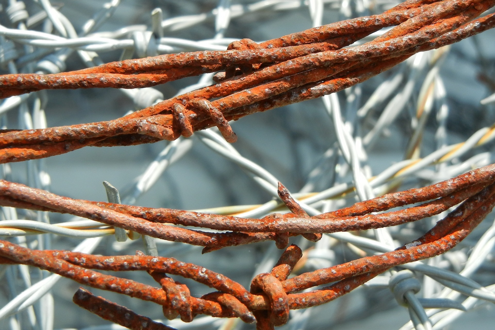

# barbed

> [!CAUTION]
> This project is pretty much experimental and new releases WILL BREAK, VERY OFTEN.

`barbed` is a small Rust workspace for Twitch and Twitch-adjacent integrations.

The root `barbed` crate currently includes:

- OAuth (authorize URL, device code flow, token refresh, signed state verification)
- Helix request builders and response parsers
- EventSub WebSocket decoding, chat subscription helpers, and a native async stream client
- Checked-in Twitch surface catalogs plus generated low-level Helix/EventSub registries
- Twitch IRC parsing plus an optional native async IRC client
- Chat emotes from Twitch, 7TV, BetterTTV and FrankerFaceZ (the `barbed-emotes` crate, re-exported as `barbed::emotes`)
- HMAC signing helpers
- Trait-based auth/session abstractions with in-memory reference implementations

Optional feature flags add integrations for specific runtimes:

- `cloudflare-worker` — send prepared requests via the Cloudflare Workers Fetch API
- `reqwest-client` — native HTTP helpers built on `reqwest`, including `emotes::EmoteClient`
- `tokio-eventsub` — native EventSub WebSocket client using `tokio` and `tungstenite`
- `tokio-irc` — native Twitch IRC client using `tokio`

Workspace crates:

- `barbed` — core Twitch/OAuth/EventSub/IRC APIs
- `barbed-emotes` — emotes without I/O, usable by itself (it builds for wasm): one model for all four providers, parsers for their answers that check every id and image address, word matching with modifiers (7TV zero-width, FrankerFaceZ and BetterTTV effects), a set loader driven by requests the caller makes, and the proxy routes a client and its server share

Generated Twitch surface data lives in [`twitch_catalog`](/Users/jan/sugoijan/barbed/twitch_catalog/summary.json) and is refreshed by [`tools/twitch_surface.py`](/Users/jan/sugoijan/barbed/tools/twitch_surface.py).

> [!NOTE]
> Disclaimer: this crate is heavily vibecoded, if you don't like it, don't use it.
